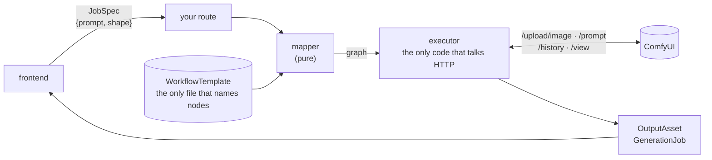

<div align="center">

# comfyui-job-pipeline

**A Claude skill: ComfyUI behind one boundary, so your frontend never holds a node id.**

Re-export a workflow and node `6` becomes node `12`. An app that wrote its prompt into `graph["6"]` now writes
it nowhere, and nothing says so. This skill puts a template between the app and the graph, checks that template
against the workflow, and finds the places in your code that still reach past it.


</div>

---

> [!IMPORTANT]
> **Tested against a mock server, not against ComfyUI.** The client follows the endpoints and answer shapes in
> ComfyUI's own `server.py` and `execution.py` (master branch, read on 2026-11-11), and the 51 tests run it
> against `tests/mock_comfy.py`, a stand-in built from that reading. It has not been run against a live ComfyUI.
> [Run it once](#first-run-against-a-real-comfyui) before you rely on it.

## The shape



| Piece | It is | It may know |
|---|---|---|
| **JobSpec** | `{"service": "image", "inputs": {"prompt": "…", "shape": "portrait"}}` | product words only |
| **WorkflowTemplate** | the exported workflow + which input lands on which node + the output node | node ids, class names |
| **Mapper** | a pure function: template + inputs → the graph to send | the template format |
| **Executor** | upload, submit, wait, fetch | ComfyUI's HTTP API |
| **OutputAsset** | a saved file and where it came from | nothing about ComfyUI |

## Before and after

<table>
<tr><th>Before: the component is the pipeline</th><th>After: the component knows its product</th></tr>
<tr>
<td width="50%">

```tsx
const graph = structuredClone(workflow);
graph['6'].inputs.text = prompt;
graph['5']['inputs']['width'] = portrait ? 576 : 768;
const sampler = Object.values(graph)
  .find((n) => n.class_type === 'KSampler');

await fetch('http://127.0.0.1:8188/prompt', {
  method: 'POST',
  body: JSON.stringify({ prompt: graph }),
});
```

</td>
<td width="50%">

```tsx
const job = await fetch('/api/generate', {
  method: 'POST',
  headers: { 'Content-Type': 'application/json' },
  body: JSON.stringify({
    service: 'image',
    inputs: { prompt, shape: portrait ? 'portrait' : 'square' },
  }),
}).then((r) => r.json());
```

</td>
</tr>
</table>

Both files are in [`examples/`](examples). The leak finder on each, unedited:

```console
$ python3 scripts/find_leaks.py examples/before
GenerateButton.tsx:9: node-id-index: graph['6'].inputs.text = prompt;
GenerateButton.tsx:10: node-id-index: graph['5']['inputs']['width'] = portrait ? 576 : 768;
GenerateButton.tsx:11: node-id-index: graph['5']['inputs']['height'] = portrait ? 1024 : 768;
GenerateButton.tsx:12: class-type: const sampler = Object.values(graph).find((node) => node.class_type === 'KSampler');
GenerateButton.tsx:12: node-class-name: const sampler = Object.values(graph).find((node) => node.class_type === 'KSampler');
GenerateButton.tsx:15: comfy-endpoint: const queued = await fetch('http://127.0.0.1:8188/prompt', {
GenerateButton.tsx:23: comfy-endpoint: const history = await fetch(`http://127.0.0.1:8188/history/${queued.prompt_id}`).then((r) => r.json());
GenerateButton.tsx:26: node-id-index: const image = entry.outputs['9'].images[0];
GenerateButton.tsx:27: comfy-endpoint: window.open(`http://127.0.0.1:8188/view?filename=${image.filename}&type=output`);
9 leaks in 1 file

$ python3 scripts/find_leaks.py examples/after
no leaks found (patterns only; see --help)
```

## The thing it catches

The example workflow, re-exported with one node renumbered and the sampler swapped for another class. The
template still points at the old graph:

```console
$ python3 scripts/comfy_pipeline.py check txt2img-basic.template.json
txt2img-basic.template.json: input "prompt": node 2 is not in the workflow
txt2img-basic.template.json: input "quality": node 5 is a KSamplerAdvanced, the template expects KSampler
txt2img-basic.template.json: input "seed": node 5 is a KSamplerAdvanced, the template expects KSampler
txt2img-basic.template.json: template txt2img-basic v1, 5 inputs, 3 problems
```

Exit 1, before anything is sent. A template names every node twice, by id and by class, and that second name
is what notices the move.

## Install

```bash
git clone https://github.com/DevCrazyCube/claude-skill-comfyui-job-pipeline ~/.claude/skills/comfyui-job-pipeline
```

Python 3.8 or newer. Nothing to `pip install`. Claude Code picks the skill up on its next start; ask it to
"audit our ComfyUI integration" or "put ComfyUI behind a job pipeline".

## Use

**1. Export your workflow in API format** (an object of node id → `class_type` + `inputs`; a normal save is
refused by `check`) and write a template beside it. [`examples/txt2img-basic.template.json`](examples/txt2img-basic.template.json)
is a complete one:

```json
"shape": {
  "type": "choice",
  "default": "square",
  "choices": {
    "square":   {"width": 768,  "height": 768},
    "portrait": {"width": 576,  "height": 1024}
  },
  "to": [
    {"node": "4", "class_type": "EmptyLatentImage", "input": "width",  "key": "width"},
    {"node": "4", "class_type": "EmptyLatentImage", "input": "height", "key": "height"}
  ]
}
```

**2. Check it, and see what would be sent:**

```console
$ python3 scripts/comfy_pipeline.py check examples/txt2img-basic.template.json
examples/txt2img-basic.template.json: template txt2img-basic v1, 5 inputs, 0 problems

$ python3 scripts/comfy_pipeline.py map examples/txt2img-basic.template.json examples/spec.json
```

`map` prints the whole graph with the spec's values written in: the prompt on node 2, 576 × 1024 on node 4,
10 steps and seed 42 on node 5. It needs no server.

**3. Run a job:**

```bash
python3 scripts/comfy_pipeline.py run TEMPLATE.json SPEC.json --server http://127.0.0.1:8188 --out outputs
```

It prints each saved file, then one line for the job. A failed job is one line too. Pointed at a port where
nothing listens:

```console
$ python3 scripts/comfy_pipeline.py run examples/txt2img-basic.template.json examples/spec.json --server http://127.0.0.1:9
job 0c1c942b-fbbc-4542-a4ef-2a75218f1e91: failed: cannot reach http://127.0.0.1:9/prompt: [Errno 111] Connection refused
```

**4. From your own code:**

```python
import comfy_pipeline as cp

template = cp.WorkflowTemplate.load('templates/txt2img-basic.template.json')
job = cp.run_job(template, {'prompt': 'a red bicycle', 'shape': 'portrait'},
                 cp.ComfyExecutor('http://127.0.0.1:8188'), 'outputs')
job.status      # 'done' or 'failed'; a failed job is returned, not raised
job.outputs     # [OutputAsset(id, kind='image', path, meta)]
job.error       # the reason, when it failed
```

[`examples/after/server/generate.py`](examples/after/server/generate.py) is a route handler built on it; a test
runs it.

**5. Keep it that way.** In CI:

```bash
for t in templates/*.template.json; do python3 scripts/comfy_pipeline.py check "$t" || exit 1; done
python3 scripts/find_leaks.py src --allow 'src/generation/*'
```

<details>
<summary><b>Template reference</b></summary>

| Key | Meaning |
|---|---|
| `id`, `version` | recorded on every job; bump `version` when behaviour changes |
| `service` | the product word a JobSpec asks for (`image`) |
| `provider` | must equal the executor's (`comfyui`) |
| `workflow` | a file beside the template, or the graph inline |
| `inputs.<name>.type` | `text`, `int`, `float`, `choice`, `image` |
| `inputs.<name>.required` / `.default` | one or neither, never both. With neither, a field that is not given keeps the workflow's own value |
| `inputs.<name>.choices` | for `choice`: a word → a value, or → an object picked apart by each target's `key` |
| `inputs.<name>.to[]` | `{"node", "class_type", "input", "key"?}`: where the value is written |
| `output` | `{"node", "class_type"}`: the node whose images are the result |

An `image` input is a local path. It is uploaded first and the name the server stored it under is written into
the graph.

</details>

<details>
<summary><b>What <code>check</code> refuses</b></summary>

A workflow that is not in API format · no inputs · an unknown type · `required` together with a `default` ·
an empty `to` · a node that is not in the workflow · a node of another class · an input the node does not have ·
an input that is wired to another node (writing it would cut the wire) · a `choice` without choices · a default
that is not one of the choices · a choice that lacks a target's `key` · a default of the wrong type · an output
node that is missing or of another class.

</details>

<details>
<summary><b>What the leak finder can and cannot see</b></summary>

| It reports | It cannot see |
|---|---|
| `graph["6"]["inputs"]`, `graph['6'].inputs`, `entry.outputs["9"]` | a node id built at run time (`graph[id]`) |
| `class_type` | your own custom node names |
| `/prompt"`, `/history/`, `/view?filename`, `/upload/image`, `/object_info`, `ws?clientId`, `:8188` | a base URL read from config and joined elsewhere |
| seven common node class names (`KSampler`, `CLIPTextEncode`, `SaveImage`, …) | any other class name |

It reads lines, not syntax, so a hit in a comment counts like a hit in code. A clean run means "none of these
patterns", not "no coupling".

</details>

<details>
<summary><b>What the executor does and does not do</b></summary>

- `POST /upload/image`, `POST /prompt`, `GET /history/{prompt_id}` (polled), `GET /view`.
- A refused workflow (HTTP 400) becomes `PromptRejected` with ComfyUI's `node_errors`; a run whose history says
  `status_str: "error"` becomes `ExecutionFailed`; no result in time becomes `ExecutionTimeout`.
- **No WebSocket**, so no progress and no previews.
- **Images only.** Any other output key (`gifs`, audio, …) is listed in the job's `not_saved`, never dropped
  silently and never saved.
- Files are saved as `<job id>-<n>.<ext>`. The server's file name is kept in `meta`, never used as a path.
- No authentication beyond the `headers` you pass. No queue management, no cancel.

</details>

## First run against a real ComfyUI

Nobody has done this yet. With ComfyUI running and a checkpoint of your own in the example workflow
(`ckpt_name` in [`examples/txt2img-basic.workflow.json`](examples/txt2img-basic.workflow.json) is a placeholder):

```bash
python3 scripts/comfy_pipeline.py run examples/txt2img-basic.template.json examples/spec.json --out outputs
```

A PNG in `outputs/` and `job …: done, 1 saved` means the reading of `server.py` holds for your version. If it
does not, the error names the endpoint; please open an issue with it and your ComfyUI version.

## Tests

```console
$ python3 -m unittest discover -s tests
...................................................
----------------------------------------------------------------------
Ran 51 tests in 6.331s

OK
```

They cover the template checks, the mapper, the executor against the mock server (including a refused workflow,
a failed run, a timeout on a fake clock, an upload whose bytes must arrive unchanged, a server that is down and
an answer that is not JSON), the job, the command line, the leak finder's patterns, and the `after` example.

## Repo layout

```
SKILL.md                               what Claude reads: the pieces, the rules, the audit steps
scripts/comfy_pipeline.py              template, mapper, executor, job; check / map / run
scripts/find_leaks.py                  ComfyUI knowledge outside the boundary
examples/txt2img-basic.workflow.json   a small text-to-image graph in API format, written for this repo
examples/txt2img-basic.template.json   its template
examples/spec.json                     a JobSpec
examples/before/  examples/after/      the same button, coupled and decoupled
tests/mock_comfy.py                    the stand-in server
tests/test_pipeline.py  tests/test_find_leaks.py
```

## Credits

ComfyUI is its authors' project: <https://github.com/comfyanonymous/ComfyUI>. The node class names in the
example are ComfyUI's; the example graph, the template format and all code here were written for this repo.
None of ComfyUI's code is included.

## Related

- [claude-skill-evidence-first-research](https://github.com/DevCrazyCube/claude-skill-evidence-first-research): the log format behind the "read it in the source, then say what was run" rule used here.
- [claude-skill-agent-progress-log](https://github.com/DevCrazyCube/claude-skill-agent-progress-log): an append-only progress log for a repo several agents work in.

## License

[MIT](LICENSE)
